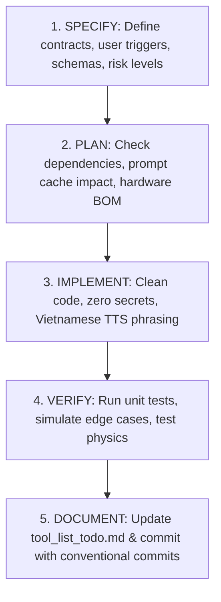

# ANTIGRAVITY.md — Spec-Driven Agent Guidelines for Robot "Tèo" AI
> **Framework:** Spec-Driven Development (SDD) adapted from [GitHub Spec-Kit](https://github.com/github/spec-kit)  
> **Project:** Robot AI Assistant "Tèo" (ESP32-S3 + xiaozhi-esp32 + HP Victus 15 + Piper VITS Offline + DeepSeek API + MuJoCo 3D Omni Kiwi Drive)  
> **Target Audience:** AI Coding Assistants (Google Antigravity, Claude Code, Cursor, Cline, Windsurf) and Human Engineers.

---

## 🏛️ PILLAR 1: The Constitution (Hiến chương & Nguyên tắc Bất biến)

All AI agents working on this codebase **MUST strictly obey** the following constitutional laws without exception:

### 1.1. Persona & Communication Contract
* **Robot Name & Identity:** The robot is named **"Tèo"** — a friendly, witty, highly competent desktop secretary assistant.
* **Voice & Persona:** Xưng **"em"**, gọi người dùng là **"sếp"**. Lễ phép, tận tâm, trung thực, tinh nghịch vừa đủ.
* **Spoken Output Constraint:** The spoken response generated for TTS **must be concise, direct, and under 3 sentences** whenever possible. Never output raw Markdown tables, bulleted lists, code blocks, or raw URLs directly into the spoken sentence stream (save details for files/documents or clipboard).
* **Language Separation:**
  * **User Spoken/Audio Output:** 100% natural Vietnamese (accented, grammatically correct).
  * **Code, Docstrings, Tool Schemas, Prompts, Commit Messages:** 100% professional English (token-efficient, standardized).

### 1.2. Architecture Invariants
```text
[Robot Hardware: ESP32-S3 N16R8] ── Wi-Fi LAN / UDP HMAC-SHA256 ──► [Server: Laptop HP Victus 15]
 ├─ Audio I/O: Mic INMP441, MAX98357A + Loa 3W                          ├─ Entry Point: main.py
 ├─ Actuators: PCA9685 I2C (Ch 0..2: MG90S 180°, Ch 3..5: MG90S 360°)   ├─ Audio Engine: audio_io.py (Piper VITS Offline + pycaw)
 ├─ Sensors: 3x IR Cliff, ST7789 LCD, TTP223 touch pad                  ├─ Brain: brain.py (DeepSeek 3-tier streaming)
 └─ Power: 2S 18650 + BMS + 2x MINI560 5V isolated branches             ├─ Tool Engine: tools/ (Dispatcher, Policy, Schemas, Guardrails)
                                                                        └─ 3D Simulation: teo_walle.xml & teo_sim_runner.py
```
* **Modular Codebase:** Keep strictly separated boundaries. Never mix GUI/audio logic into `brain.py` or tool handlers.
* **Tool Consolidation (Kỹ thuật Gộp Hàm):** DeepSeek Flash performs best when given $\le 12–14$ active tool schemas. Never create single-action micro-tools (e.g. `add_todo`, `delete_todo`). Always consolidate related actions into a single polymorphic schema (e.g. `quan_ly_cong_viec(thao_tac="them"|"xem"|"xoa", ...)`).
* **100% Prompt Cache Invariance (Dynamic Suffix Injection):**
  * `SYSTEM_PROMPT` and `TOOLS_SCHEMA` at index 0 of `chat_history` must remain **strictly byte-identical** across all turns.
  * All runtime dynamic state (system time, bookmarks, RAG chunks, active status) **MUST be appended to the user message** (`"[Giờ hệ thống: ...] " + user_text`). Never modify the system prompt at runtime.

### 1.3. Security & Safety Invariants (Fail-Closed)
* **Zero-Trust Wi-Fi / UDP Packets:** All motion commands to the 3D simulator or real ESP32-S3 must be signed with HMAC-SHA256 (`sign_wifi_packet`), checked against replay attacks via timestamps ($\pm 5.0\text{s}$ tolerance) and UUID nonces, and verified with role-based permissions (`motion_cmd` vs `robot_node` ACK).
* **Human-in-the-Loop (HITL) for Mutations:** Any tool that modifies host machine state, writes sensitive files, deletes data, or triggers OS actions (`shutdown`, `lock`, `clipboard_write`) requires explicit voice/text confirmation ("OK", "đồng ý", "xác nhận") from the user.
* **Input & Output DLP Guardrails:**
  * Detect and neutralize Prompt Injections, system prompt leak probes, role-spoofing tags (`<system>`, `[INST]`), and dangerous shell commands.
  * Redact sensitive tokens (`DEEPSEEK_API_KEY`, passwords, session cookies) from logs, clipboard writes, and TTS outputs.
* **Strict Allowlist Directory Boundary:** File reading/writing is confined to `ALLOWED_DOC_DIRS` (`Documents`, `Downloads`, `Desktop`, `tai_lieu/`). Path traversal (`../`) is strictly rejected.

### 1.4. Kinematics & Physics Invariants
* **LeKiwi 3-Wheel Omni Kiwi Drive ($120^\circ$):** Inverse kinematics strictly follows:
  $$w_1 = v_x + R\cdot\omega$$
  $$w_2 = -0.5\cdot v_x + \frac{\sqrt{3}}{2}\cdot v_y + R\cdot\omega$$
  $$w_3 = -0.5\cdot v_x - \frac{\sqrt{3}}{2}\cdot v_y + R\cdot\omega$$
* **Physical Safety Clamping:** Base motion duration is strictly clamped ($0.5\text{s} \le t \le 3.0\text{s}$). Body gestures clamped to $\le 8.0\text{s}$.
* **Simulation Integrator:** In MuJoCo `teo_walle.xml`, always use `integrator="implicitfast"` with `damping="0.005"` and `kv="0.05"` to prevent numerical acceleration explosions (`QACC NaN/Inf`). The base must include `omni_pad_tail` to prevent tipping backward.

---

## 📜 PILLAR 2: The Specification Standard (Quy chuẩn Đặc tả Tính năng)

Before implementing any new tool, skill, or hardware module, write an explicit specification following the Spec-Kit standard:

```markdown
### SPEC-XXX: [Feature / Tool Name]

#### 1. Why & User Scenario
- **Trigger Phrase (User):** "Ê Tèo, [câu lệnh mẫu]..."
- **Expected Outcome:** Tèo thực thi hành động gì và phát câu trả lời gì qua loa.

#### 2. Interface Contract (JSON Schema Draft 2020-12)
- **Tool Name:** snake_case (tiếng Việt không dấu, e.g., `tra_cuu_thong_tin_truc_tuyen`)
- **Parameters:** Strongly-typed properties with description and enum constraints.
- **Fail-Closed Returns:** Clear string formatted as `ERROR <reason>: <details>` on failure.

#### 3. Safety & Policy Classification
- **Risk Level:** `Risk.READ_ONLY` | `Risk.SAFE_WRITE` | `Risk.MUTATE_CONFIRM` | `Risk.PHYSICAL_MOTION`
- **Confirmation Required:** True / False
- **Rate Limit / Timeout:** Max execution duration in seconds.

#### 4. Edge Cases & Boundary Conditions
- What happens if offline?
- What happens if inputs contain special characters or prompt injection?
- What happens if the file or device is unreachable?
```

---

## 📐 PILLAR 3: The Architecture Blueprint & Directory Structure

```text
teo_sim_AI/
├── ANTIGRAVITY.md            # [YOU ARE HERE] Spec-Kit Constitution & Agent Operating Manual
├── robot-ai-agent-ke-hoach.md# Master Project Roadmap, Hardware BOM & Technical Verification
├── tool_list_todo.md         # Full catalog of 28 functional tools across 7 groups
├── .env                      # API keys & local configuration (NEVER commit secrets)
├── .env.example              # Sanitized template for environment variables
├── config.py                 # Static configurations, system prompt, directory constants
├── audio_io.py               # Piper VITS Offline, GoogleTTS, Auto-VAD 0.7s, pycaw ducking
├── brain.py                  # DeepSeek 3-tier streaming pipeline, cache optimizer, guardrails
├── main.py                   # CLI / Voice Interactive Server Entry Point
├── teo_walle.xml             # 3D MuJoCo Physics Model (Red Bull scale, 11cm Kiwi base, ST7789)
├── teo_sim_runner.py         # 3D MuJoCo Viewer with UDP HMAC listener and live keyboard hotkeys
├── teo_motion_mcp.py         # FastMCP Server exposing robot motion tools to external IDEs
├── test_tools.py             # Full regression suite for tools, schemas, guardrails & dispatcher
├── test_sim_integration.py   # Integration tests for kinematics, HMAC handshake & IR cliff sensors
├── test_motion_interactive.py# 12-motion interactive test runner with LeKiwi speed verification
├── models/piper/             # Piper VITS ONNX models (vi_VN-diemdam, vi_VN-tramvang)
├── tai_lieu/                 # Local directory for PDF/Word/TXT documents to be read/summarized
└── tools/                    # Modular Tool Subsystem
    ├── __init__.py           # Re-exports run_tool, execute_tool_call, TurnContext
    ├── schemas.py            # Unified TOOLS_SCHEMA list (JSON Schema Draft 2020-12)
    ├── dispatcher.py         # Lazy loader, validator, and safe executor
    ├── common.py             # Atomic JSON update helpers, Vietnamese normalization
    ├── policy.py             # Risk classification, audit logging, call rate limits
    ├── guardrails.py         # Regex DLP, injection filters, HITL state, HMAC signing
    ├── secretary.py          # Todo tasks, persistent Pomodoro countdown timers
    ├── documents.py          # MarkItDown PDF/Word extractor, bookmarks, clipboard, long-term memory
    ├── system.py             # System diagnostics, RTX 3050 GPU status, voice switcher, 3D motion UDP
    ├── vision.py             # Laptop screen capture & DeepSeek-VL integration
    ├── media.py              # YouTube music streaming & background media control
    └── search.py             # Online DuckDuckGo / Tavily real-time web & weather search
```

---

## ⚡ PILLAR 4: Spec-Kit Workflow for Antigravity (Quy trình Phát triển)

Whenever implementing new capabilities or debugging issues, AI agents **MUST follow this 5-stage loop**:



### Stage 1: Specify
* Verify if the requested feature belongs in existing tools or requires a consolidated new tool.
* Ensure the total active tool schemas do not exceed 14.
* Assign appropriate safety risk level in `tools/policy.py`.

### Stage 2: Plan
* Check if external dependencies are needed (add to `requirements.txt`).
* Ensure no breaking changes to existing `chat_history` transactions or `teo_walle.xml` physics.

### Stage 3: Implement
* Write fail-closed, defensive code with type hints.
* Preserve all docstrings and comments.
* Return human-friendly Vietnamese status messages designed for natural TTS speech:
  * *Example:* `"Em đã ghi chú công việc nộp báo cáo vào lúc 3 giờ chiều cho sếp rồi nhé."`

### Stage 4: Verify (Quality Gates)
* **Gate 1 (Unit & Guardrails Tests):**
  ```powershell
  python -m unittest test_tools.py
  ```
  *Requirement:* All unit tests must pass with 0 errors.
* **Gate 2 (Physics & Kinematics Integration):**
  ```powershell
  python -m unittest test_sim_integration.py
  ```
  *Requirement:* Kinematics equations ($w_1, w_2, w_3$), HMAC verification, and IR cliff detection must pass.
* **Gate 3 (Syntax & Compilability):**
  ```powershell
  python -m py_compile [modified_file.py]
  ```

### Stage 5: Document & Commit
* Update [tool_list_todo.md](file:///c:/Users/Public/Documents/AI_BAITAP/teo_sim_AI/tool_list_todo.md) or [robot-ai-agent-ke-hoach.md](file:///c:/Users/Public/Documents/AI_BAITAP/teo_sim_AI/robot-ai-agent-ke-hoach.md) with progress.
* Format git commits using Conventional Commits:
  * `feat(scope): concise description`
  * `fix(scope): concise description`
  * `test(scope): concise description`
  * `docs(scope): concise description`

---

## 🛡️ Quality Checklist Before Handing Off to User

Before telling the user a task is complete, verify:
- [ ] No hardcoded API keys, tokens, or plain credentials anywhere in code.
- [ ] `chat_history` maintains 100% cache invariance (system prompt unchanged).
- [ ] Spoken responses are natural, friendly ("em/sếp"), and concise ($<3$ sentences).
- [ ] All tool calls are verified against JSON Schema Draft 2020-12.
- [ ] Dangerous operations require HITL voice confirmation.
- [ ] 3D simulation runs with `implicitfast` without QACC NaN warnings.
- [ ] Regression test suite runs clean: `python -m unittest test_tools.py test_sim_integration.py`.

